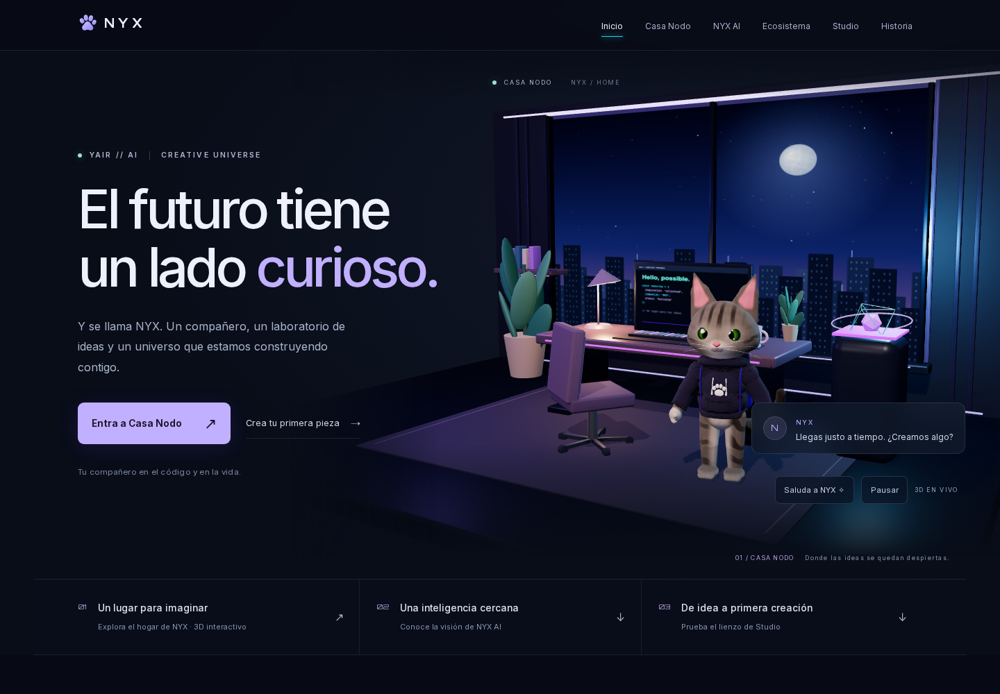

# NYX — Creative Lab

**NYX / YAIR // AI**: un universo creativo alrededor de un gato atigrado, un hogar digital y la visión de un asistente de IA con personalidad.

> Tu compañero en el código y en la vida.

## Si vas a continuar el proyecto, empieza aquí

**Empieza por [README-CONTINUAR.md](README-CONTINUAR.md), el punto de entrega más reciente, y después lee [CONTINUIDAD.md](docs/CONTINUIDAD.md).** Contiene el estado real, las decisiones aprobadas, los cambios realizados, los pendientes priorizados y un mensaje listo para retomar con otro agente o en otro chat.

Antes de modificar código, lee también [AGENTS.md](AGENTS.md) y la documentación local de Next en `node_modules/next/dist/docs/`.

## Qué funciona ahora

| Área | Estado real |
|---|---|
| Web oficial `/` | Portada inmersiva, presentación del proyecto, navegación responsive y estados del ecosistema. |
| Casa Nodo `/casa-nodo` | Habitación 3D compartida con la portada, cámara orbital y tres encuadres, tres ambientes, lámpara y pausa. |
| NYX | Rig v2 conservado; GLB con 17 animaciones: un idle y 16 reacciones. |
| Primer lienzo de Studio `/#studio` | Título, subtítulo, tres paletas, formato horizontal/cuadrado, borrador local y exportación PNG. |
| NYX AI | Visión ilustrativa. Todavía no hay conversación conectada a una IA. |
| Editor completo, cuentas y comunidad | Pendientes. No hay backend, autenticación ni base de datos. |



## Cambios de esta entrega

- Dirección visual **Casa Nodo / After Hours**: ciudad nocturna, luz cálida, mobiliario, plantas, libros y un núcleo luminoso animado.
- Portada integrada con el entorno real, mensajes más humanos y composición específica para móvil/tablet.
- Marca con rostro atigrado + «Nyx» y favicon de carita sobre fondo violeta, adaptados de la lámina de identidad del autor.
- Primer experimento funcional de Studio, con exportación de la misma imagen que se previsualiza.
- Controlador de reacciones compartido, limpieza de acciones y temporizadores, y separación entre arrastre y clic.
- Pausa, movimiento reducido, suspensión del render fuera de pantalla/en pestañas ocultas y recuperación visual al perder WebGL.
- Render ligero en pantallas pequeñas: DPR 1 y sin sombras dinámicas. El GLB sigue teniendo 99.448 triángulos; aún no se ha creado un LOD.
- Pruebas Playwright, comprobaciones automáticas de PRs, documentación actualizada y capturas comparativas.

El historial de reparaciones previas del cuello, saludo, materiales y parpadeo está en [Fase 4](docs/phase-4/README.md). El detalle de esta entrega y sus límites está en [Fase 5](docs/phase-5/README.md).

## Desarrollo local

Node.js 24 es la versión usada por los workflows del repositorio.

```sh
npm ci
npm run dev
```

Abre `http://localhost:3000`. Para usar otro puerto: `npm run dev -- --port 3110`.

## Verificar antes de integrar cambios

```sh
npm run lint
npm run typecheck
npm run build
npx playwright install chromium
npm run test:e2e
npm audit
```

La suite inicia su propio servidor en el puerto 3111. Para comprobar un servidor existente:

```sh
NYX_TEST_URL=http://localhost:3110 npm run test:e2e
```

Última verificación de la implementación: **7 pruebas aprobadas**, lint/TypeScript/build correctos y cero vulnerabilidades conocidas en la auditoría realizada el 11 de noviembre de 2026. Esto no certifica rendimiento en teléfonos físicos ni un futuro estado de las dependencias. Evidencia: [pruebas](docs/phase-5/evidence/e2e-result.json) y [comprobación estática](docs/phase-5/evidence/static-check.json).

## GitHub Pages

[Workflow de despliegue](.github/workflows/deploy-pages.yml): un push a `main` construye y publica la exportación estática bajo `/NYX/`. Verifica el resultado en [GitHub Actions](https://github.com/yairV1/NYX/actions); la presencia de un commit en `main` no garantiza que el despliegue haya terminado.

Para reproducir el build:

```sh
GITHUB_PAGES=true NEXT_PUBLIC_GITHUB_PAGES=true npm run build
```

Las dos variables deben configurarse juntas. `next/link` gestiona las rutas internas y `withBase` en `src/content/nyx-assets.ts` prefija los recursos públicos. No poner claves de IA en variables `NEXT_PUBLIC_*`; una función real de IA necesitará un servicio de servidor aparte de esta exportación estática.

## Documentación y archivos clave

- [Continuidad y siguientes tareas](docs/CONTINUIDAD.md).
- [Arquitectura actual](docs/ARCHITECTURE.md).
- [Dirección visual](docs/DESIGN-SYSTEM.md).
- [Brief e identidad aprobada](docs/NYX-CREATIVE-LAB-BRIEF.md).
- [Antes/después y límites de la entrega](docs/phase-5/README.md).
- [Escena compartida](src/components/casa-nodo/CasaNodoScene.tsx) y [entorno procedural](src/components/world/NodoRoom.tsx).
- [Personaje y animaciones](src/components/casa-nodo/NyxModel.tsx).
- [Editor local](src/components/studio/StudioCanvas.tsx).
- [Pruebas de navegador](tests/experience.spec.ts).

No se deben inventar capacidades, estadísticas ni testimonios. Mantener visible el estado real de cada parte del ecosistema.

## Retomar los últimos avances

Consulta [README-CONTINUAR.md](README-CONTINUAR.md) para el estado de entrega,
comprobaciones, pendientes y pasos de la siguiente sesión.
