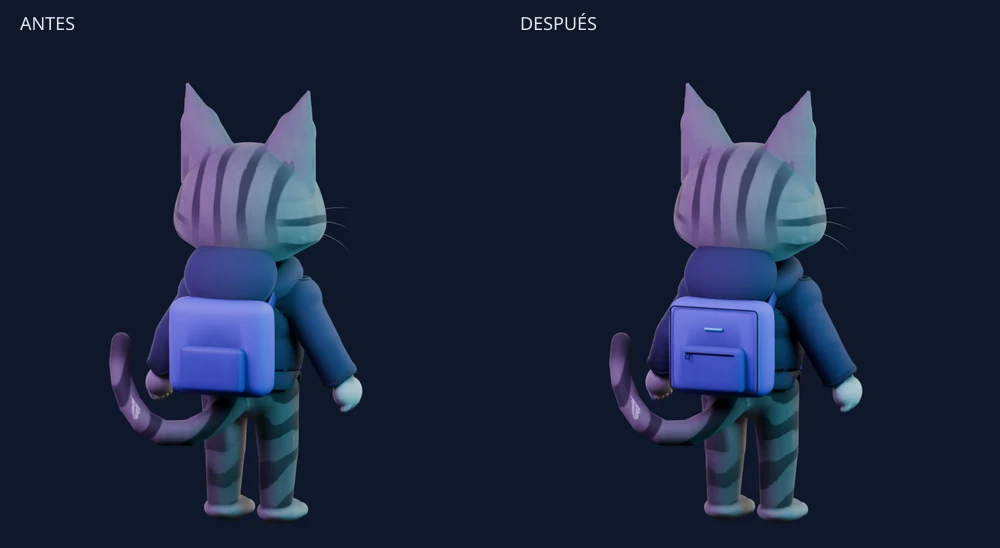
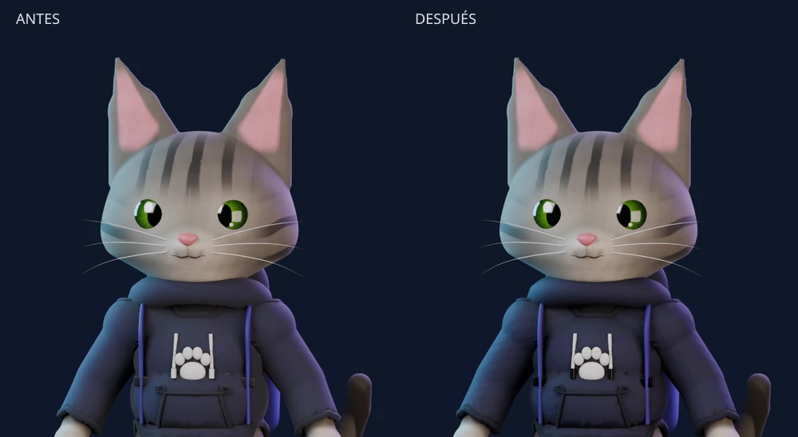

# NYX — acabado del personaje y dirección editorial

Revisión del 12 de noviembre de 2026. Evolución del Nyx_rig v2 antropomórfico;
no se cambia su anatomía, rig ni biblioteca de acciones. Sin audífonos permanentes.

## Decisiones y alcance

La comparación inicial mostró un personaje pequeño frente al mobiliario y accesorios
con superficies demasiado uniformes. Se trabajó en dos escalas: acabado de los
objetos y jerarquía de la experiencia web.

- Tejido mediante mapa normal tangente empaquetado y exportable, compartido entre
  hoodie y mochila. UVs nuevas únicamente en accesorios que no tenían UVs; las
  coordenadas del pelaje y los ojos se conservan.
- Herrajes metálicos y remates de cordones; borde cosido, cierre, tirador y señal
  cian en la mochila. Los cuatro detalles nuevos reciben pesos de los vértices
  cercanos de la mochila para acompañar el rig existente.
- Cámara de bienvenida más próxima y personaje a escala 0,8 en Casa Nodo (antes 0,7).
  El hero aproxima también su cámara. Las proporciones internas no cambian.
- Sección de identidad con tres renders del modelo real: retrato, saludo y espalda.
  Selector con botones nativos, estado anunciado y textos alternativos.
- Ecosistema con tres composiciones: núcleo orbital, lienzos superpuestos y
  experimento geométrico. CSS sin otro contexto WebGL ni recursos externos.
  Los enlaces apuntan a funcionalidades/información existentes; AI sigue marcado
  en definición.
- Estilos nuevos encapsulados en CSS Modules. Movimiento decorativo solo al hover,
  desactivado con `prefers-reduced-motion`.

## Fuentes reproducibles

Fuente anterior (inmutable): `artifacts/phase-4/nyx-v2-quality-c.blend`.
Candidato editable: `artifacts/design-refinement/nyx-polished-v2.blend`.
Escenas con cámaras y luces: `artifacts/design-refinement/{before,after-v2}/presentation.blend`.
Los `.blend` permanecen locales, conforme al `.gitignore`; scripts, GLB, WebP y
reportes sí se pueden versionar. El original externo Nyx_master.blend no se toca.

```bash
blender -b artifacts/phase-4/nyx-v2-quality-c.blend --python-exit-code 1 \
  -P tools/blender/polish_character.py -- \
  --out artifacts/design-refinement/nyx-polished-v2.blend

blender -b artifacts/design-refinement/nyx-polished-v2.blend --python-exit-code 1 \
  -P tools/blender/render_character_identity.py -- \
  --out artifacts/design-refinement/after-v2 --size 800 --samples 32
```

Los generadores rechazan sobrescribir el candidato. Para repetir, elegir otra
ruta. Exportar con `tools/blender/export_web.py`, Draco, WebP a 2048/calidad90 y
un `--action NOMBRE` por cada acción de `evidence/export-validation.json`.
Validar el archivo antes de reemplazar el GLB público:

```bash
blender -b --python-exit-code 1 -P tools/blender/validate_polish.py -- \
  artifacts/design-refinement/nyx-polished-v2.glb \
  docs/design-refinement/evidence/export-validation.json
blender -b --python-exit-code 1 -P tools/blender/check_glb_blink.py -- \
  artifacts/design-refinement/nyx-polished-v2.glb \
  docs/design-refinement/evidence/blink-validation.json
```

Capturas de navegador: iniciar `npm run dev -- --port 3110`, ejecutar
`node tools/capture-design-refinement.mjs`.

## Evidencia y límites

Comparaciones con cámaras/luces idénticas, Cycles CPU, AgX, 800×800, denoise.
Antes 24 muestras; después 32. El aumento de muestras reduce ruido; no implica
cambio de geometría ni es una medición objetiva de calidad. Se inspeccionaron
frente, retrato, espalda y saludo.




GLB nuevo: 3.115.380 bytes, 100.020 triángulos, una armadura de 89 huesos,
17 animaciones, 0 triángulos degenerados. 45 mallas glTF, 46 objetos de malla
tras importación. Normal maps presentes, detalles nuevos con pesos normalizados.
La prueba del parpadeo del GLB conserva error radial máximo 0,0003 y suma de pesos 1.

**No equivale a una retopología o un rediseño completo del personaje.** Permanecen
las piernas largas, el modelado facial y los gestos anteriores. Tampoco se ha
resuelto todavía el LOD de 30–60 mil triángulos. Esta entrega añade solo 572
triángulos al modelo previo y pesa unos 77 KB más, pero todavía requiere ese
trabajo independiente para móviles modestos.

No se validaron Safari/Firefox ni móvil físico. Las capturas de móvil son Chromium
con viewport emulado. No se atribuye una puntuación 10/10 a partir de estos cambios.

Corrección previa a publicar: la conversión de las curvas nuevas ahora deselecciona
los demás objetos; mantiene los modificadores de armadura de ropa y accesorios.
La validación exige explícitamente esos modificadores tras reimportar. El primer
candidato local sin `-v2` se descarta y no debe usarse.

Para regenerar los WebP/comparaciones, renderizar también con
`tools/blender/render_poster.py -- --out artifacts/design-refinement/posters-v2`
y ejecutar `node tools/build-refinement-media.mjs`.

## Verificación de la entrega final

- `npm run lint` y `npm run typecheck`: pasan.
- Build normal: pasa. Build final estático con ambas variables de Pages: pasa.
- `NYX_TEST_URL=http://localhost:3110 npm run test:e2e`: **7/7**, 2,5 minutos.
  Comprueba 390/768/1440, menú, Studio/PNG/persistencia, controles y retorno a idle,
  movimiento reducido y recuperación ante pérdida de WebGL.
- Capturas finales a 390/1440 y selector de tres retratos: sin desbordamiento ni
  errores de página. La prueba utiliza Chromium con SwiftShader.
- Huella del GLB entregado en `evidence/final-asset.json`. Todos los renders finales
  y los WebP públicos proceden de la revisión `-v2`.
