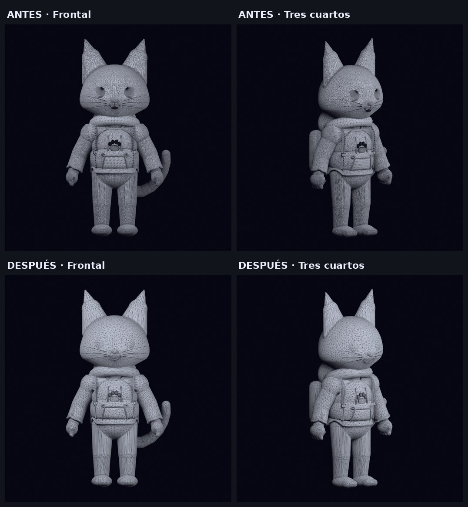
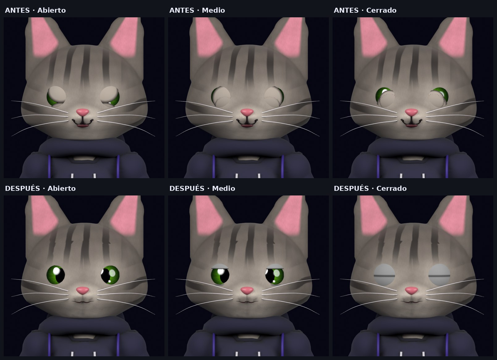
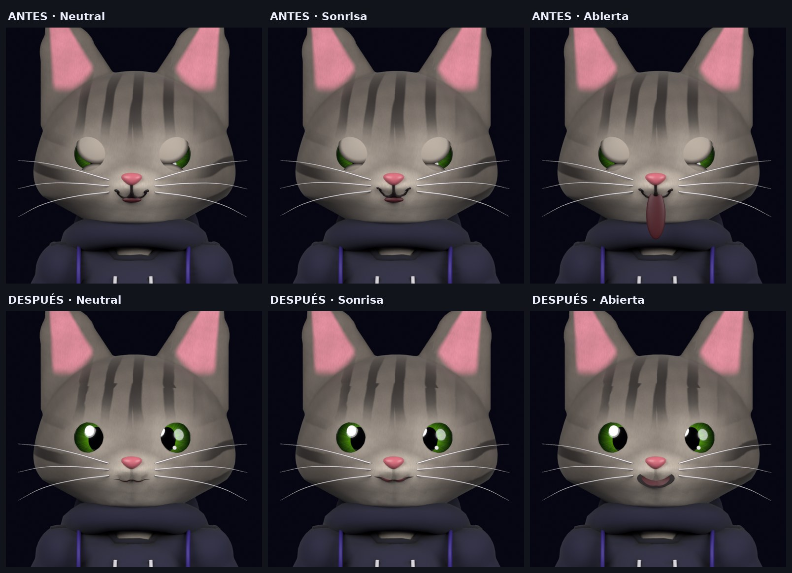

# Fase 2 — Casa Nodo y evolución de Nyx_rig v2

## Decisión del autor

Casa Nodo es el hogar principal. Se evoluciona el gato antropomórfico del rig v2.
Audífonos únicamente en modo concentración. Jardín de lo Posible y Distrito
Umbral quedan para fases futuras. Las imágenes de la landing pertenecen a la
exploración anterior y todavía no constituyen la adaptación del rig v2.

## Fuente y alcance de la auditoría

No llegaron las capturas anunciadas en el mensaje. Se inspeccionó directamente
`/home/yair/Proyectos/nyx/blender/source/Nyx_master.blend` con Blender 5.2.2 LTS.
La correspondencia de este archivo con la copia personal más reciente del autor
queda por confirmar. El original no fue sobrescrito.

Inventario completo en `evidence/rig.json`; métricas en `baseline.json`.
Las cifras globales incluyen una armadura antigua y geometría auxiliar, por lo
que no deben confundirse con el coste de exportación del personaje.

- Armadura principal `RIG_Nyx`, 163 huesos, 83 deformantes.
- Armadura antigua `NyxRig`, 25 huesos. Excluirla del export.
- 42 mallas en GEO/FACIAL/ACCESSORIES, 106 879 vértices de autoría.
- 28 acciones en el archivo, con mezcla de nombres y procedencias.
- Cero shape keys en la fuente.
- Cola de ocho huesos deformantes, orejas de dos segmentos por lado.
- Controles de mirada, párpados, cejas, boca y mandíbula ya presentes.
- Sin modificadores de simulación en el inventario.
- La escena completa tiene 409 996 triángulos evaluados. No equivale al LOD web.
- Se detectaron 192 aristas de longitud cero en la escena completa.
  Localizar su malla antes de reparar; las aperturas de ropa no son automáticamente defectos.

Se inspeccionaron renders frontal, posterior, laterales, superior y perspectiva.
La silueta y el atuendo v2 son reconocibles. Los ojos se leen pequeños frente a
la referencia ilustrada; el rostro tiene poco volumen expresivo en boca/cejas.
La mochila es rígida y las prendas necesitan pruebas de hombro, codo y cadera.
Los renders no validan todos los rangos de deformación.

## Cambios priorizados

| Prioridad | Cambio | Motivo / estado |
|---|---|---|
| Imprescindible | Separar antiguo y actual al exportar | Implementado por selección explícita de colecciones y armadura |
| Imprescindible | Validar cierre palpebral | Hecho: cierre esférico en 8 pasos, sin penetración en 9 etapas. Falta material de pelaje en el párpado |
| Imprescindible | Boca y mejillas coordinadas | Hecho: bucles de quads, cavidad y claves Smile/MouthOpen. Mejillas sin correctivos |
| Imprescindible | Normalizar contratos de acciones | Inventariadas; decidir y migrar nombres en Fase 3 |
| Imprescindible | LOD y reducción manual de mallas | Hecho por decimación: 212 966 → 51 032 triángulos. Sin retopología manual |
| Imprescindible | Verificar hombros, rodillas y ropa en poses extremas | Pendiente de corrección artística basada en poses |
| Deseable | Shape keys de sonrisa, parpadeo y apertura | Starter implementado reutilizando controles reales |
| Deseable | Movimiento secundario de cola y orejas | Helpers aditivos y horneado de resortes implementados |
| Deseable | Cordones articulados | Tres huesos por cordón, pesos y puntas vinculadas |
| Deseable | Mochila con retraso y correas deformables | Pendiente; evitar separarla del cuerpo al simular |
| Deseable | Cejas visibles y correctivos de mejilla | Requiere esculpido, no se soluciona creando claves vacías |
| Futuro | Audífonos de concentración | Accesorio modular todavía por modelar y validar |
| Futuro | Visemas y lip-sync | Después de resolver labios y cavidad oral |
| Futuro | Colisiones de ropa y mochila | Ensayo y bake específico; no forma parte del resorte actual |
| Futuro | KTX2 y LOD dinámico | Etapa de optimización web posterior |

## Archivos y qué hacen

- `tools/blender/audit_rig.py` inventaría mallas, huesos, constraints y acciones.
- `tools/blender/prepare_character.py` crea cinco canales semánticos distribuidos
  en siete mallas (Blink.L/R, Smile.L/R, MouthOpen), agrega helpers de resorte,
  seis huesos para cordones y materiales de la paleta.
- `tools/blender/bake_secondary.py` copia una acción existente y hornea offsets
  de resorte amortiguado dependientes de la rotación del padre.
- `tools/blender/export_web.py` exporta las colecciones del personaje, limita
  influencias a cuatro, conserva morphs, permite Draco y remuestrea texturas.
- `tools/blender/check_deformation.py` mide cambios reales de vértices al
  activar morphs y muestrea los offsets de los helpers.
- `tools/blender/refine_phase2.py` limpia geometría degenerada, decima las
  mallas pesadas, reconstruye el parpadeo sobre la esfera del ojo y la boca.
- `tools/blender/validate_refinement.py` comprueba holgura del párpado en
  nueve etapas y cobertura del ojo cerrado.
- `tools/blender/render_face_review.py` y `render_geometry_review.py` generan
  renders de revisión con encuadre fijo; `compose_review_sheets.py` (Pillow)
  arma las hojas comparativas de antes y después.

Los scripts rechazan salidas ya existentes. El preparador está diseñado para la
fuente v2 inventariada, no como herramienta universal para cualquier personaje.

Los morphs capturan deltas evaluados en pose neutral. Son una base editable.
No activar el morph y el control óseo equivalente a la vez: produciría doble
deformación. La apertura de boca no constituye un visema completo. El resorte
limita amplitud, pero no resuelve contactos ni autocolisiones. Su respuesta a
traslación pura y la continuidad exacta del loop necesitan una ampliación.
Los materiales de entorno usan Principled BSDF. Se preservan las texturas del
personaje; el acabado toon final se dirigirá con iluminación y ajustes posteriores.

## Prueba inmediata

1. Desde la carpeta del proyecto, ejecutar `npm install` si faltan dependencias.
2. Ejecutar `npm run dev -- --port 3109`.
3. Abrir http://127.0.0.1:3109/casa-nodo.
4. Arrastrar para orbitar; rueda o gesto de dos dedos para acercarse.
5. Usar los botones de lámpara y restablecimiento de cámara.

La escena usa React Three Fiber y drei, geometría local y materiales PBR.
Contiene escritorio, lámpara, silla vacía, monitor, ventana y luz ambiental.
Renderiza bajo demanda, limita DPR a 1.5 y carga el Canvas solo en cliente.
Es un prototipo espacial. NYX está integrado con el GLB refinado y reproduce
`Idle_Secondary`; con movimiento reducido permanece en reposo.
Rapier y postprocesado corresponden a una fase posterior de interacción.

Fuentes web completas en `src/app/casa-nodo/` y `src/components/casa-nodo/`.

## Reproducir en Blender paso a paso

Ejecutar desde `/home/yair/Proyectos/NYX`. Si los archivos ya existen, elegir
nuevos nombres. Usar `--python-exit-code 1` para que los errores aborten la tarea.

```bash
mkdir -p artifacts/phase-2

blender --background --python-exit-code 1 \
  /home/yair/Proyectos/nyx/blender/source/Nyx_master.blend \
  --python tools/blender/prepare_character.py -- \
  --out artifacts/phase-2/prepared.blend

blender --background --python-exit-code 1 \
  artifacts/phase-2/prepared.blend \
  --python tools/blender/bake_secondary.py -- \
  --action Idle --out artifacts/phase-2/secondary.blend

blender --background --python-exit-code 1 \
  artifacts/phase-2/secondary.blend \
  --python tools/blender/export_web.py -- \
  --out artifacts/phase-2/nyx.glb --draco \
  --texture-size 1024 --action Idle_Secondary

blender --background --python-exit-code 1 \
  artifacts/phase-2/secondary.blend \
  --python tools/blender/check_deformation.py -- \
  artifacts/phase-2/deformation.json
```

Para examinar las claves en Blender, abrir el candidato, seleccionar por ejemplo
`GEO_lid_up.L`, ir a Datos del objeto > Shape Keys y mover `Blink.L` entre 0 y 1.
Poner todos los valores en cero antes de reproducir la animación ósea.
En el Action Editor elegir `Idle_Secondary` para la prueba de resortes.

El candidato ya generado está en `artifacts/phase-2/nyx-v2-casa-nodo.blend`.
Su GLB de revisión está en `artifacts/phase-2/nyx-v2-preview.glb`.
Estos binarios se excluyen de Git por tamaño; los scripts permiten reproducirlos.

## Exportación y límites reales

La prueba final exportó 3 631 800 bytes, 42 mallas, 89 joints y siete primitivas
con morphs. Conserva `Idle_Secondary`, una copia técnica de la acción existente.
Draco aparece en las 42 primitivas. Las tres imágenes incrustadas se comprobaron
a 1024×1024. El GLB se reimportó en un proceso limpio de Blender.

Se usa PNG comprimido y reducción de resolución. Draco comprime geometría,
no texturas. KTX2/Basis no se ha implementado ni validado aquí. El resultado
supera ligeramente el objetivo previo de 3 MB y todavía requiere un LOD web.
Un GLB comprimido no reduce automáticamente el coste de dibujar su geometría.

La biblioteca de animaciones final y el cierre artístico de las expresiones
siguen pendientes. Esta entrega prepara herramientas y pruebas reproducibles.

Documentación consultada para la integración R3F:
https://r3f.docs.pmnd.rs/getting-started/installation

## Resultados de verificación — candidato inicial (histórico)

Corresponde a `artifacts/phase-2/nyx-v2-casa-nodo.blend` y a su GLB de revisión,
antes de la corrección. Se conserva como línea base de las comparativas.

- GLB de 3 631 800 bytes, 42 mallas, 212 966 triángulos.
- 192 caras degeneradas y 192 aristas de longitud cero.
- Párpados con morph lineal y boca con interior separado.
- npm reportaba 10 vulnerabilidades, una crítica.

## Corrección de la Fase 2 — resultados (10 de noviembre de 2026)

Candidato: `artifacts/phase-2/nyx-v2-refined-final.blend`.
GLB publicado: `public/assets/nyx/models/nyx-v2-refined.glb`.
Verificación independiente en `evidence/glb-verification.json`.

| Aspecto | Antes | Después |
|---|---|---|
| Triángulos del personaje | 212 966 | 51 032 |
| Mallas | 42 | 40 |
| Caras degeneradas / aristas de longitud cero | 192 / 192 | 0 / 0 |
| Tamaño del GLB | 3 631 800 bytes | 3 316 568 bytes |
| Armaduras en el GLB | 1 (`RIG_Nyx`) | 1 (`RIG_Nyx`, 89 joints) |
| Parpadeo | morph lineal | 8 pasos esféricos por párpado |
| Boca | interior separado | bucles de quads + cavidad, `Smile` y `MouthOpen` |
| Vulnerabilidades npm | 10 (1 crítica) | 0 |

Notas sobre estas cifras:

- **El GLB publicado pesa 3,32 MB, no 2,59 MB.** Los 2 587 880 bytes
  correspondían a una exportación intermedia con solo dos primitivas con morphs,
  anterior a las claves de parpadeo. El informe junto al GLB quedó desfasado y
  se ha corregido. El objetivo de 3 MB sigue sin cumplirse.
- La armadura antigua `NyxRig` continúa en los `.blend` de trabajo, pero no
  está en el GLB: un único skin, raíz de escena `RIG_Nyx`.
- Las texturas atigradas se conservan: `T_Nyx_fur`, `T_Nyx_normal` y `NYX_eye`
  a 1024×1024.
- `Idle_Secondary` incluye cuatro canales de pesos, de modo que el parpadeo
  viaja dentro de la animación exportada.

### Comparativas visuales

Misma cámara por columna; fila superior antes, inferior después.





Para regenerarlas:

```bash
for pair in "before nyx-v2-casa-nodo" "after nyx-v2-refined-final"; do
  set -- $pair
  blender --background --python-exit-code 1 artifacts/phase-2/$2.blend \
    --python tools/blender/render_geometry_review.py -- --out docs/phase-2/evidence/renders/$1
  blender --background --python-exit-code 1 artifacts/phase-2/$2.blend \
    --python tools/blender/render_face_review.py -- --out docs/phase-2/evidence/renders/$1
done
python3 tools/blender/compose_review_sheets.py docs/phase-2/evidence/renders
```

Los PNG individuales no se versionan; solo las tres hojas comparativas.

### Verificación web

Con Next 16.4.6, three 0.187, React Three Fiber 9 y drei 10:

- `npm run lint`, `npm run typecheck` y `npm run build`: sin errores.
  Rutas `/`, `/_not-found` y `/casa-nodo` prerenderizadas como estáticas.
- `npm audit`: 0 vulnerabilidades.
- Escritorio (1440×900): el GLB y el decodificador Draco cargan con 200,
  NYX aparece junto al escritorio y los píxeles cambian entre fotogramas solo
  en la zona del personaje, lo que confirma que `Idle_Secondary` se reproduce.
- Móvil (390×844): sin desbordamiento horizontal y animación activa.
  **Defecto encontrado y corregido:** en vertical NYX quedaba fuera del encuadre
  inicial. `CasaNodoScene` aleja ahora la cámara en pantallas verticales.
- Consola: cero errores. Dos avisos de three 0.187 que no afectan al resultado:
  `THREE.Clock` obsoleto y `PCFSoftShadowMap` sustituido por `PCFShadowMap`.

No verificado: dispositivo móvil real (solo emulación de tamaño), Safari y
Firefox, rendimiento en GPU de gama baja, lectores de pantalla.

### Pendientes

Visuales, visibles en las comparativas:

- **Los párpados no tienen material de pelaje.** Cerrados se leen como discos
  grises lisos con una línea. El cierre es correcto geométricamente, pero no
  está terminado artísticamente.
- La sonrisa es muy sutil y no hay correctivos de mejilla ni cejas visibles.
- La decimación automática deja triangulación irregular en cabeza y hoodie.
  Hay que revisarla en poses extremas; no sustituye a una retopología manual.

Técnicos:

- GLB de 3,32 MB frente al objetivo de 3 MB. Opciones: KTX2/Basis para las
  texturas o reducir las claves de parpadeo.
- NYX tarda unos segundos en aparecer en Casa Nodo y no hay indicador de carga
  (el `Suspense` del modelo no tiene fallback).
- Migrar `THREE.Clock` cuando R3F/drei lo resuelvan; revisar el tipo de sombra.
- La validación de párpados mide holgura y cobertura, no la calidad del contacto
  entre párpado superior e inferior.
- Sigue pendiente lo ya anotado: contratos de nombres de acciones, mochila y
  correas, hombros/rodillas/ropa en poses extremas, visemas, colisiones.
- La correspondencia del `.blend` fuente con la copia más reciente del autor
  continúa sin confirmar.

Recomendación antes de la Fase 3: dar material de pelaje a los párpados y
decidir si la decimación actual es aceptable o se hace retopología.
