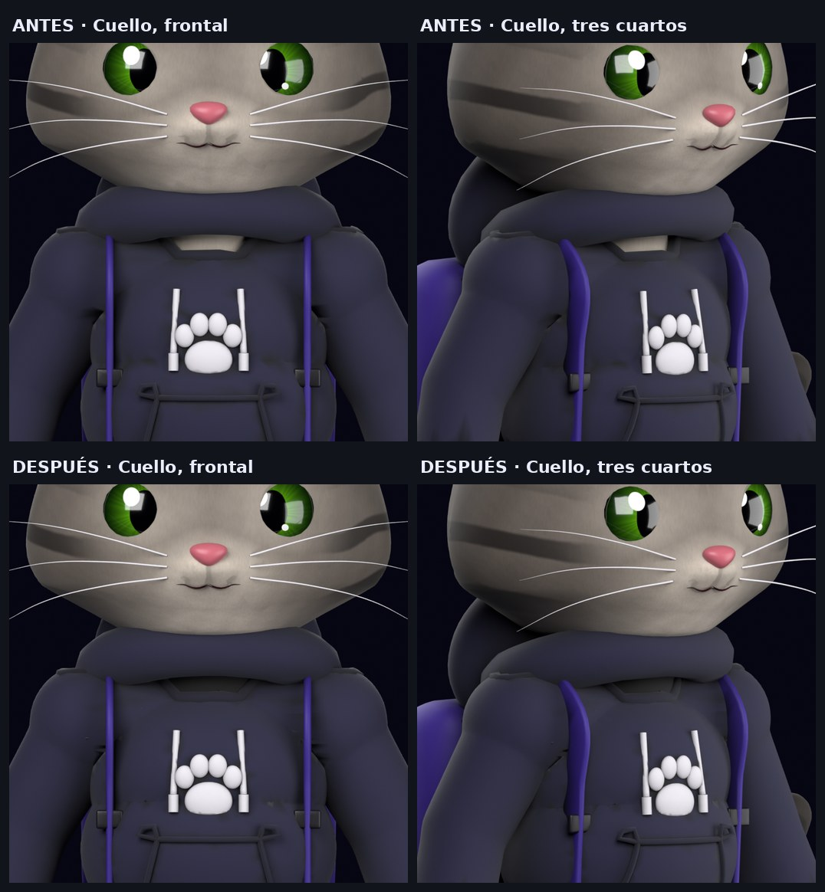
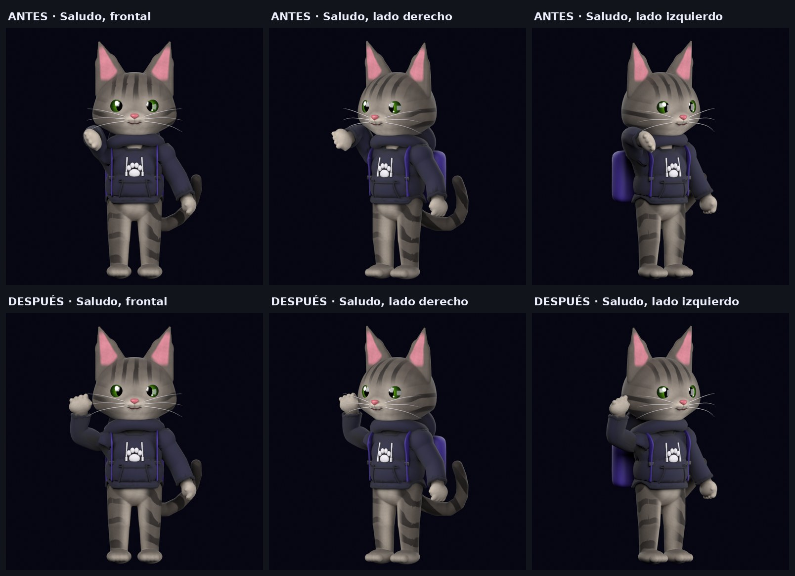
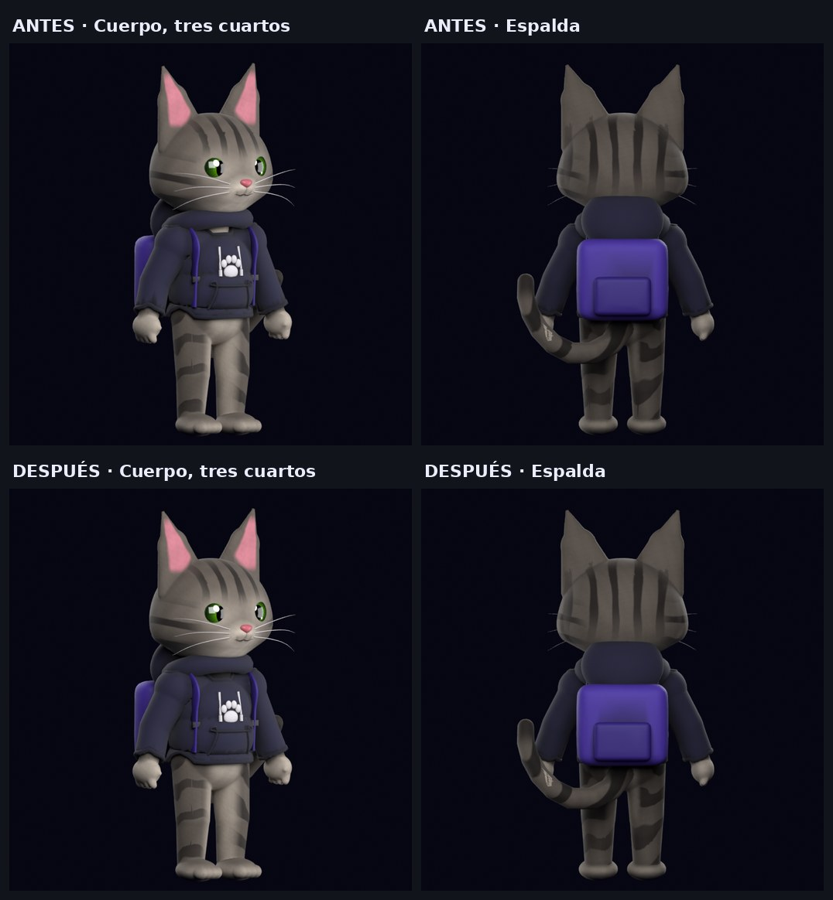

# Fase 4 — Auditoría, reparación y calidad visual de NYX 3D

Rama `feature/nyx-3d-quality`. Punto de restauración: etiqueta local
`restore/before-3d-quality` y copia del GLB anterior y de los scripts en
`artifacts/backup-2026-11-10/` (fuera de git).

## Qué versión se ve en la web

- Fuente: `/home/yair/Proyectos/nyx/blender/source/Nyx_master.blend`
  (28 de septiembre). Es idéntico byte a byte a `Nyx_rig_v2.blend` del
  portafolio, así que la web parte del modelo más reciente. No se ha modificado.
- La web no muestra ese archivo directamente sino un GLB derivado por scripts:

```
Nyx_master.blend
  └ prepare_character.py   → artifacts/phase-2/nyx-v2-casa-nodo.blend
      └ fix_character.py   → artifacts/phase-4/nyx-v2-fixed-c.blend     (nuevo)
          └ refine_phase2.py → artifacts/phase-4/nyx-v2-quality-c.blend
              └ export_web.py → public/assets/nyx/models/nyx-v2-refined.glb
```

El mismo GLB se usa en el hero de la landing y en `/casa-nodo`.

## Diagnóstico

| Problema | Causa comprobada | Origen |
|---|---|---|
| Cuello visible bajo el saco | El borde superior del saco tiene una muesca y la capucha no la tapa: queda una rendija por la que se ve el pelaje del cuello | Modelo fuente |
| Brazo «roto» al saludar | La acción `Wave` levantaba el brazo solo con una rotación en Z. La bisagra del codo quedaba apuntando hacia delante, así que el antebrazo se doblaba hacia la cámara con la mano colgando | Animación fuente |
| Bordes irregulares, superficies facetadas | La reducción de malla de la Fase 2 dejaba el 18 % de los triángulos en cuerpo y saco | Fase 2 |
| Puntos claros sobre el saco | Cuerpo y prenda se reducen por separado y el pelaje atravesaba la tela | Fase 2 |
| Saco gris en la web en vez de azul marino | Blender multiplica el tinte del brillo de tela por su peso (0,15); glTF solo exporta el tinte y el navegador lo aplicaba al 100 % | Exportación |
| Texturas blandas | Se exportaban a 1024 px con calidad 75 desde originales de 4096 px | Fase 3 |

No se encontraron problemas de pesos ni de constraints en el brazo: la
deformación es correcta, el fallo estaba en las claves de la animación.

## Correcciones

**Saco y cuello** (`fix_character.py`)

- Se añade `GEO_hoodie_collar`, un cuello interior acanalado (240 caras) que
  rodea el cuello justo por fuera del cuerpo y por dentro del saco. Usa el
  material oscuro del saco y copia los pesos del cuerpo, así que sigue al cuello
  en todas las poses. No cambia la silueta ni tapa la huella ni los cordones.

**Saludo** (`fix_character.py`)

- El brazo se abre hacia el lado y gira 90° sobre su eje, con lo que el codo se
  dobla hacia arriba y la mano queda junto a la cabeza. El saludo es un vaivén
  del antebrazo. Se conservan la anticipación, la sonrisa, la inclinación de
  cabeza y la duración (3 s).

**Calidad** (`refine_phase2.py`, `export_web.py`)

- Reducción de malla menos agresiva: 42 % en cuerpo y saco, 55 % en el resto
  (antes 18 % y 30 %). Todas las caras siguen con sombreado suave. No se aplicó
  subdivisión.
- El cuerpo se hunde 3,5 cm donde el saco lo cubre (3 356 vértices), para que
  no atraviese la tela ni en reposo ni al doblar los brazos.
- Texturas a 2048 px en WebP con calidad 90 y UV con 14 bits de precisión.
- El peso del brillo de tela se incorpora al tinte, de modo que el navegador
  muestra el mismo azul marino que Blender.

| | Antes | Después |
|---|---|---|
| Triángulos | 51 032 | 99 448 |
| Tamaño del GLB | 2 486 736 bytes | 3 037 988 bytes |
| Texturas | 1024 px, calidad 75 | 2048 px, calidad 90 |
| Mallas | 40 | 41 |
| Armaduras / huesos | 1 / 89 | 1 / 89 |
| Animaciones | 17 | 17 |

## Evidencia visual

Renders de Blender con la misma cámara: fila superior antes, inferior después.





Regenerar con `tools/blender/render_diagnostic.py`.

## Revisión de las demás animaciones

Se renderizó un fotograma clave de las 16 animaciones restantes de frente y en
tres cuartos. Solo `Wave` tenía el brazo mal articulado. Observaciones:

- `Point`: el brazo se extiende hacia delante. Correcto.
- `Celebrating`: los dos brazos suben sin deformaciones.
- `Thinking`: el puño queda a la altura del hombro, no llega a la barbilla. No
  es un error de articulación, pero el gesto se lee poco. Sin cambios.
- Expresiones faciales: sin intersecciones visibles.

No se revisaron fotograma a fotograma las transiciones completas de cada clip.

## Validación

| Prueba | Resultado |
|---|---|
| Parpadeo en el `.blend`, 9 etapas | Pasa (`evidence/blink-validation.json`) |
| Parpadeo en el GLB con la fórmula del navegador | Desviación 0,0003, suma de pesos 1,00 (`evidence/glb-blink-check.json`) |
| Reimportación del GLB | 1 armadura, 89 huesos, 0 caras degeneradas, 0 aristas de longitud cero, 17 acciones |
| `npm run lint`, `typecheck`, `build` | Sin errores |
| Build de GitHub Pages | Correcto |
| Navegador, landing | Carga el GLB nuevo (3 037 988 bytes), saludo correcto, saco azul marino, cuello cerrado, cero errores en consola |
| Rendimiento | 60 fotogramas por segundo, modelo visible en 0,8 s |

Dos de los fallos solo aparecieron al probar en el navegador, no en los renders
de Blender: el cuello interior salió con las caras al revés (los materiales de
la web no dibujan caras traseras y Cycles sí) y el brillo de la tela. Ambos
están corregidos y comprobados en la página.

Límites de la validación:

- El rendimiento se midió en este equipo, en local y en modo desarrollo. No se
  probó en móvil real ni con red limitada.
- El cuello y el saludo se inspeccionaron de cerca en la landing. En
  `/casa-nodo` se comprobó que carga el mismo GLB, que el saludo se reproduce,
  60 fotogramas por segundo y cero errores, pero NYX se ve pequeño en esa cámara
  y no se repitió la inspección de detalle.
- No se probaron Safari ni Firefox.

## Pendientes y recomendaciones

- **Proporciones.** El modelo tiene piernas largas y silueta casi humana; la
  hoja de identidad pide cabeza grande, cuerpo compacto y patas cortas. Es un
  rediseño del modelo, fuera del alcance de esta fase.
- Pequeños brillos en la costura superior del bolsillo del saco (geometría de la
  propia prenda, no cuerpo atravesando).
- `Thinking` ganaría con la mano en la barbilla.
- El GLB vuelve a superar por poco los 3 MB. Si el peso importa más que la
  nitidez, exportar con `--texture-size 1024` lo deja en 2,87 MB.
- La mano del saludo va cerrada; abrir los dedos lo haría más expresivo.
- Sigue sin movimiento secundario (cola, orejas) fuera del reposo.
