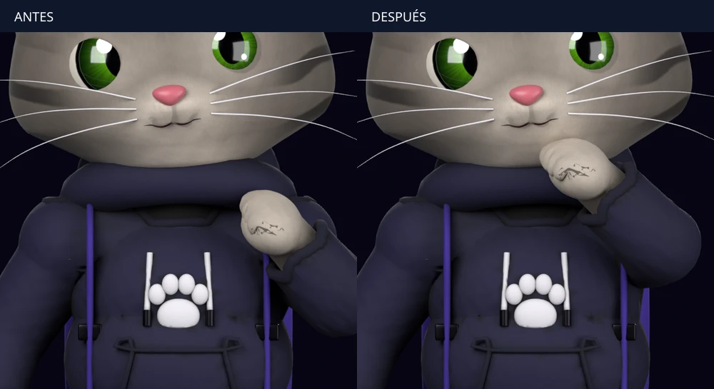

# NYX — gesto Pensar

Tanda acotada del 12 de noviembre de 2026: mejorar una acción, validarla y guardar
el avance en main. No representa un porcentaje medido de cuota de la cuenta.

## Cambio

La pata izquierda se acerca al mentón, en lugar de quedarse a la altura del
hombro. Se conserva el rig, la ropa y la inclinación de cabeza. El cierre de
los dedos se suaviza; no se remodela la mano. La acción también vuelve a su pose
inicial dentro del propio clip, antes del fundido del reproductor web.

A 30 fps: entrada 1–20, pausa 20–42 y regreso 42–61 (dos segundos). Curvas Bézier
con tiradores AUTO_CLAMPED. No se altera ninguna de las otras 16 acciones.

- Fuente: `artifacts/design-refinement/nyx-polished-v2.blend`.
- Nuevo editable: `artifacts/thinking-refinement/nyx-thinking-v2.blend`.
- GLB: `artifacts/thinking-refinement/nyx-thinking-v2.glb`.
- Script: `tools/blender/refine_thinking.py -- --out RUTA_NUEVA.blend`.
  Ejecutar con Blender en background y `--python-exit-code 1` sobre la fuente.
- Exportar con `export_web.py`, las 17 acciones existentes, Draco,
  texturas WebP 2048 y calidad 90, como en la entrega anterior.

## Evidencia

Cámaras comunes de `render_diagnostic.py`, Cycles, 640×640, 24 muestras.
Revisión de frente, perfil, entrada, regreso y reposo. El contacto se aproxima
por FK; no es una simulación física. Los nudillos pasan de z≈1,79 a z≈1,98.
La diferencia máxima entre matrices de huesos al inicio y final es cero.

Persiste detalle irregular en la superficie de los dedos del modelo original,
visible en primerísimo plano; esta tanda no incluye retopología ni promete
corregir esa superficie. No se añaden funciones de IA ni cambios de anatomía.

Cierre retomado el **18 de noviembre de 2026**, conservando PR #8 de diseño.
Los 16 clips ajenos a Thinking tienen datos de animación idénticos al GLB anterior
(comparación de tiempos y valores por canal). La geometría sigue en 100.020
triángulos; esta entrega no es el LOD móvil pendiente.

## Verificación final del 18 de noviembre

- Lint, TypeScript y build estático de Pages: pasan.
- Prueba dirigida de Casa Nodo: pasa, incluyendo Saludar, Pensar, retorno al
  reposo, cámara, ambiente y pausa. No se repitió la suite completa de la entrega anterior.
- Reimportación GLB y parpadeo: pasan; una armadura, 89 huesos y 17 clips.
- Se conservan los avisos de compatibilidad de Three (Clock/PCFSoftShadowMap)
  y la recomendación de precarga del póster; no son errores de ejecución.
- Probado con Chromium/SwiftShader. Pendiente móvil físico y otros navegadores.
